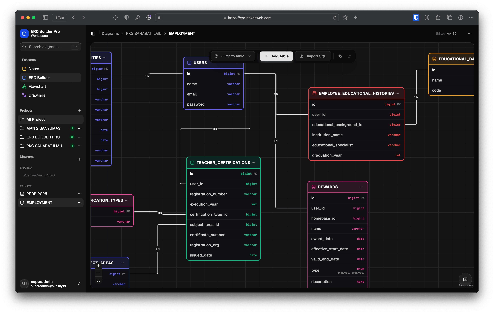

# Pengenalan

ERD Builder Pro adalah alat desain database yang menggabungkan _Entity Relationship Diagram (ERD)_, export SQL dan kode framework, catatan teknis berbasis Tiptap, flowchart, serta gambar bebas berbasis Excalidraw dalam satu workspace.

Aplikasi ini dibuat untuk **Software Developer**, **Database Architect**, dan **tim teknis** yang ingin menyimpan skema, aturan bisnis, dan alur aplikasi di satu tempat, dari perancangan sampai dokumentasi.

## Mengapa ERD Builder Pro?
- **Satu Project, banyak jenis file**: ERD, Notes, Flowchart, dan Drawing tersimpan dalam Project yang sama sehingga mudah dirujuk satu sama lain, termasuk oleh AI Assistant.
- **Kode siap pakai**: export skema ke SQL (PostgreSQL, MySQL), Laravel, Goravel, Prisma, TypeScript, dan Zod. Lihat [Export Schema & Kode](../core-features/sql-generator.md).
- **Kolaborasi Team**: Personal Workspace dan Team Workspace, peran per Project, komentar, diskusi, dan notifikasi. Lihat [Personal & Team Workspace](../workspace/personal-team-workspace.md).
- **Pilih cara pakainya**: Cloud, Self-host di server sendiri, aplikasi Desktop, atau CLI.

## Pilihan Penggunaan {/* #pilihan-penggunaan */}

| Pilihan | Cocok untuk | Database | Team Workspace |
| :--- | :--- | :--- | :--- |
| **Cloud** | Tim yang tidak ingin mengelola server | Dikelola oleh ERD Builder Pro | Ya, lewat langganan Cloud per Team yang dikelola di ERDBPro SaaS |
| **Self-host** | Kantor yang menyimpan data di server sendiri | PostgreSQL | Personal gratis; Team memerlukan lisensi Self-host Commercial |
| **Desktop** | Satu orang di komputer sendiri | SQLite lokal | Tidak ada, hanya Personal |
| **CLI** (`npx erdbpro`) | Satu orang yang sudah memakai Node.js | SQLite lokal | Tidak ada, hanya Personal |

Panduan pemasangan: [Deployment](./deployment.md) untuk Self-host, [Aplikasi Desktop](./desktop-app.md), dan [CLI](./cli.md).

## Teknologi & Pustaka
Aplikasi ini dibangun di atas teknologi modern dan pustaka *open-source* berikut:

### Infrastruktur Utama
- **Frontend**: React + Vite.
- **Backend**: Express.js.
- **Database**: PostgreSQL untuk Cloud dan Self-host, SQLite untuk Desktop dan CLI.
- **Storage**: Cloudflare R2 untuk gambar di Notes dan Drawings. Desktop dan CLI juga bisa memakai storage S3-compatible.
- **Desktop**: Tauri.

### Pustaka Inti (Credits)
Kami berterima kasih kepada pengembang di balik pustaka berikut:
- **[React Flow](https://reactflow.dev/)**: mesin canvas ERD dan Flowchart.
- **[Tiptap](https://tiptap.dev/)**: editor teks kaya (*rich text editor*) berbasis ProseMirror untuk Notes.
- **[Excalidraw](https://excalidraw.com/)**: canvas gambar bebas untuk Drawings.
- **[DBML](https://dbml.dbdiagram.io/)**: bahasa markup untuk editor DBML.

## Roadmap Mendatang
Berikut beberapa fitur besar yang sudah tersedia atau masih direncanakan:

| Fitur | Status |
| :--- | :--- |
| **AI-Powered ERD Generation** | ✅ Sudah Tersedia |
| **Kolaborasi Tim & Role-Based Access** | ✅ Sudah Tersedia (Cloud dan Self-host Commercial) |
| **Desktop Application** | ✅ Sudah Tersedia (macOS, Windows, Linux) |
| **Dukungan SQL Dialects Lebih Luas** | 🔜 Dalam Rencana |
| **Enhanced Export** | 🔜 Dalam Rencana |
| **Local Database Runner** ⚡ | 🔜 Dalam Rencana |
| **Mindmap** | 🔜 Dalam Rencana |
| **API Mapper** | 🔜 Dalam Rencana |
| **Task Workspace** | 🔜 Dalam Rencana |

:::note
Fitur di atas dirancang saling terhubung: **Mindmap** untuk merencanakan ide, **ERD & Flowchart** untuk memvisualkan struktur, **Task Workspace** untuk mengatur eksekusi, dan **API Mapper** untuk mendokumentasikan jalur data.
:::

## Lisensi

ERD Builder Pro memakai [Elastic License 2.0](https://github.com/hadziqmtqn/erd-builder-pro/blob/master/LICENSE.md) (ELv2).

- **Boleh:** memakai, men-deploy, dan memodifikasi untuk diri sendiri atau di dalam organisasi Anda, termasuk perusahaan.
- **Tidak boleh:** menyediakannya ke pihak lain sebagai layanan hosted/managed, mengakali atau menghapus fungsi license key, atau menghapus notice lisensi.
- **Team di Self-host** membutuhkan license key Self-host Commercial. Personal Workspace tetap gratis.
