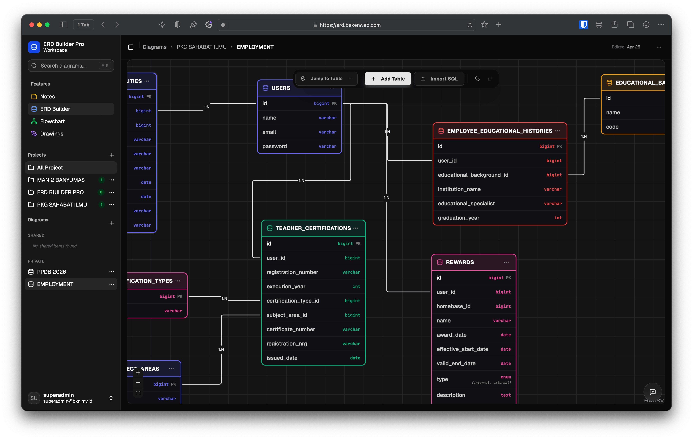

# Introduction

ERD Builder Pro is a database design tool that combines _Entity Relationship Diagrams (ERD)_, SQL and framework code export, Tiptap-based technical notes, flowcharts, and Excalidraw-based freeform drawings in one workspace.

It is built for **Software Developers**, **Database Architects**, and **technical teams** who want to keep schemas, business rules, and application flows in one place, from design to documentation.

## Why ERD Builder Pro?
- **One Project, many file types**: ERD, Notes, Flowchart, and Drawing files are stored in the same Project, so they are easy to cross-reference, including by the AI Assistant.
- **Ready-to-use code**: export schemas to SQL (PostgreSQL, MySQL), Laravel, Goravel, Prisma, TypeScript, and Zod. See [Export Schema & Code](../core-features/sql-generator.md).
- **Team collaboration**: Personal Workspace and Team Workspace, per-Project roles, comments, discussions, and notifications. See [Personal & Team Workspace](../workspace/personal-team-workspace.md).
- **Choose how you use it**: Cloud, Self-host on your own server, the Desktop app, or the CLI.

## Usage Options {/* #pilihan-penggunaan */}

| Option | Best for | Database | Team Workspace |
| :--- | :--- | :--- | :--- |
| **Cloud** | Teams that do not want to manage a server | Managed by ERD Builder Pro | Yes, through a per-Team Cloud subscription managed in ERDBPro SaaS |
| **Self-host** | Offices that keep their data on their own server | PostgreSQL | Personal is free; Team requires a Self-host Commercial license |
| **Desktop** | One person on their own computer | Local SQLite | None, Personal only |
| **CLI** (`npx erdbpro`) | One person who already uses Node.js | Local SQLite | None, Personal only |

Installation guides: [Deployment](./deployment.md) for Self-host, [Desktop App](./desktop-app.md), and [CLI](./cli.md).

## Technology & Libraries
The application is built on the following modern technologies and *open-source* libraries:

### Core Infrastructure
- **Frontend**: React + Vite.
- **Backend**: Express.js.
- **Database**: PostgreSQL for Cloud and Self-host, SQLite for Desktop and CLI.
- **Storage**: Cloudflare R2 for images in Notes and Drawings. Desktop and CLI can also use S3-compatible storage.
- **Desktop**: Tauri.

### Core Libraries (Credits)
We thank the developers behind the following libraries:
- **[React Flow](https://reactflow.dev/)**: canvas engine for ERDs and Flowcharts.
- **[Tiptap](https://tiptap.dev/)**: ProseMirror-based *rich text editor* for Notes.
- **[Excalidraw](https://excalidraw.com/)**: freeform drawing canvas for Drawings.
- **[DBML](https://dbml.dbdiagram.io/)**: markup language for the DBML editor.

## Future Roadmap
Here are some major features that are already available or still planned:

| Feature | Status |
| :--- | :--- |
| **AI-Powered ERD Generation** | ✅ Available |
| **Team Collaboration & Role-Based Access** | ✅ Available (Cloud and Self-host Commercial) |
| **Desktop Application** | ✅ Available (macOS, Windows, Linux) |
| **Broader SQL Dialect Support** | 🔜 Planned |
| **Enhanced Export** | 🔜 Planned |
| **Local Database Runner** ⚡ | 🔜 Planned |
| **Mindmap** | 🔜 Planned |
| **API Mapper** | 🔜 Planned |
| **Task Workspace** | 🔜 Planned |

:::note
The features above are designed to connect with one another: **Mindmap** for planning ideas, **ERD & Flowchart** for visualizing structure, **Task Workspace** for managing execution, and **API Mapper** for documenting data paths.
:::

## License

ERD Builder Pro uses the [Elastic License 2.0](https://github.com/hadziqmtqn/erd-builder-pro/blob/master/LICENSE.md) (ELv2).

- **Allowed:** use, deploy, and modify it for yourself or within your organization, including companies.
- **Not allowed:** provide it to others as a hosted/managed service, circumvent or remove the license key functionality, or remove license notices.
- **Teams on Self-host** require a Self-host Commercial license key. Personal Workspace remains free.
